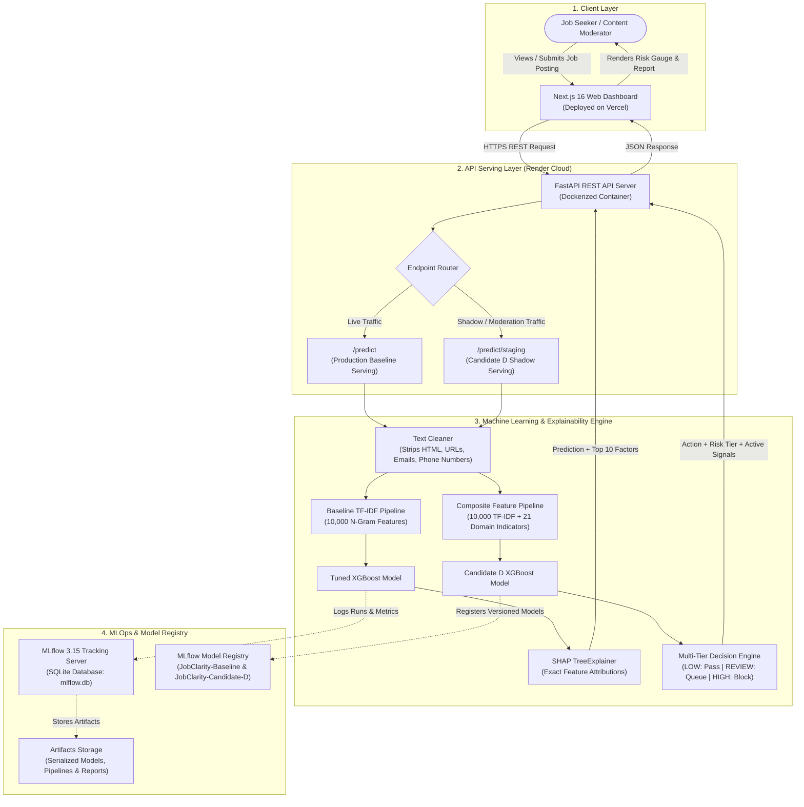
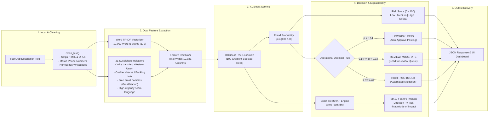

<div align="center">

# JobClarity

**AI-Powered Fake Job Detection System with Explainable AI & MLOps**

Detect fraudulent job postings in real time with Machine Learning, TreeSHAP interpretability, and MLflow experiment tracking.


**Live Web App:** [`https://jobclarity.vercel.app`](https://jobclarity.vercel.app) &nbsp;•&nbsp; **Live API:** [`https://jobclarity-0tz8.onrender.com`](https://jobclarity-0tz8.onrender.com) &nbsp;•&nbsp; **Interactive Swagger Docs:** [`/docs`](https://jobclarity-0tz8.onrender.com/docs)

</div>

---

## Overview

**JobClarity** is a production-grade AI system designed to detect fraudulent and deceptive job postings before they trick job seekers. Given any job description, the platform classifies it as **Real** or **Fake** using tuned **XGBoost** classification models, applies **TreeSHAP** (SHapley Additive exPlanations) to explain the decision, and routes predictions through a **multi-tier trust & safety moderation engine** (`PASS`, `FLAG_FOR_REVIEW`, `BLOCK`).

The system includes:
- **FastAPI Inference Microservice**: Asynchronous, containerized REST API with endpoints for production serving (`/predict`) and candidate staging evaluation (`/predict/staging`).
- **Explainable AI (XAI)**: Native TreeSHAP feature attributions surfacing the exact top positive and negative signals driving every prediction.
- **MLOps Architecture**: Automated experiment tracking and model versioning powered by **MLflow 3.15**, complete with reproducible near-duplicate graph split protocols, parameter sanitization, and model registry governance.
- **Next.js 16 Web Application**: Modern SaaS dashboard with animated risk gauges, severity tiers, and interactive explanation breakdowns.

---

## Table of Contents

- [System Architecture](#system-architecture)
- [How the Model Works](#how-the-model-works)
- [Project Links](#project-links)
- [Core Features](#core-features)
- [Repository Structure](#repository-structure)
- [Tech Stack](#tech-stack)
- [Machine Learning & MLOps Pipeline](#machine-learning--mlops-pipeline)
- [API Endpoints](#api-endpoints)
- [MLflow Experiment Tracking](#mlflow-experiment-tracking)
- [Local Installation](#local-installation)
- [Docker Deployment](#docker-deployment)
- [Testing Suite](#testing-suite)
- [Future Roadmap](#future-roadmap)
- [Author & License](#author--license)

---

## System Architecture

The JobClarity platform is decoupled into four primary layers:



---

## How the Model Works

When a job description is submitted, it travels through an end-to-end data and inference pipeline:



---

## Project Links

| Component | Platform | Link |
|---|---|---|
| **Live Web Application** | Vercel | [https://jobclarity.vercel.app/](https://jobclarity.vercel.app/) |
| **Backend REST API** | Render | [https://jobclarity-0tz8.onrender.com](https://jobclarity-0tz8.onrender.com) |
| **Interactive API Docs** | Swagger / OpenAPI | [https://jobclarity-0tz8.onrender.com/docs](https://jobclarity-0tz8.onrender.com/docs) |
| **Backend Repository** | GitHub | [https://github.com/divysaxena24/JobClarity](https://github.com/divysaxena24/JobClarity) |
| **Frontend Repository** | GitHub | [https://github.com/divysaxena24/JobClarity-frontend](https://github.com/divysaxena24/JobClarity-frontend) |

---

## Core Features

- **AI-Powered Fraud Detection**: Tuned XGBoost classifier trained to catch subtle linguistic and structural hallmarks of fake job postings.
- **Explainable AI (TreeSHAP)**: Fast, exact mathematical Shapley value feature attribution explaining *why* a posting was flagged.
- **Dual-Model Serving Architecture**:
  - **Production Baseline** (`/predict`): High global PR-AUC ($0.6904$) for text ranking.
  - **Candidate D Shadow Staging** (`/predict/staging`): $94.20\%$ precision at $\tau=0.33$ with only **4 false positives** across 3,336 legitimate postings.
- **Operational Multi-Tier Decision Rules**:
  - `LOW` ($p < 0.14$) $\rightarrow$ `PASS` (auto-approve).
  - `REVIEW` ($0.14 \le p < 0.33$) $\rightarrow$ `FLAG_FOR_REVIEW` (human moderator queue).
  - `HIGH_RISK` ($p \ge 0.33$) $\rightarrow$ `BLOCK` (high-confidence automated prevention).
- **Near-Duplicate Leakage Prevention**: Custom connected-component graph clustering ($90\%$ cosine similarity) isolating near-duplicate job descriptions across train and test sets (12,337 connected components).
- **MLflow 3.15 Experiment Tracking & Model Registry**: Unified parameter tracking, metric logging, confusion matrix visualization, artifact versioning, and PyFunc deployment wrappers.
- **Comprehensive Quality Assurance**: **314 automated unit, integration, ML, and regression tests** passing with $100\%$ success rate.

---

## Repository Structure

```
JobClarity/
├── artifacts/                  # Evaluation reports, confusion matrices, and benchmarks
│   ├── candidate/              # Baseline candidate artifacts and split metadata
│   └── evaluation/
│       ├── day2/               # Stratified held-out test evaluations
│       ├── day3/               # Near-duplicate graph grouping reports
│       ├── day4/               # Feature engineering and model staging
│       ├── day5/               # SHAP explainability and model selection reports
│       └── day6/               # MLflow experiment tracking & recovery reports
├── configs/                    # Pipeline configuration files
├── data/
│   ├── raw/                    # Raw job postings dataset
│   └── processed/              # Cleaned and validated dataset (cleaned_jobs.csv)
├── models/                     # Production model artifacts (frozen and immutable)
│   ├── tfidf_vectorizer.pkl
│   ├── xgboost_model.pkl
│   └── xgboost_model_tuned.pkl
├── notebooks/                  # Exploratory data analysis and prototyping notebooks
├── scripts/                    # Standalone execution pipelines
│   ├── run_day5_shap_and_selection.py
│   ├── run_day6_mlflow_logging.py
│   ├── run_feature_experiments.py
│   ├── run_near_duplicate_evaluation.py
│   ├── run_staging_validation.py
│   └── run_threshold_experiments.py
├── src/                        # Core source package
│   ├── api/                    # FastAPI application, routes, and schemas
│   │   ├── main.py             # App initialization and CORS setup
│   │   ├── predictor.py        # Production inference service
│   │   ├── routes.py           # GET /, GET /health, POST /predict, POST /predict/staging
│   │   └── schemas.py          # Pydantic request and response models
│   ├── explainability/         # TreeSHAP computation and attribution slicing
│   │   ├── candidate_shap_explainer.py
│   │   └── shap_explainer.py
│   ├── features/               # Text vectorization and domain indicator extractors
│   │   ├── feature_builder.py
│   │   ├── feature_pipeline.py
│   │   ├── suspicious_language.py
│   │   └── tfidf_vectorizer.py
│   ├── models/                 # Model trainers, evaluators, staging, and MLflow tracking
│   │   ├── evaluate.py
│   │   ├── experiment_tracker.py
│   │   ├── hyperparameter_tuner.py
│   │   ├── model_loader.py
│   │   ├── model_trainer.py
│   │   ├── staging_predictor.py
│   │   └── threshold_optimizer.py
│   ├── preprocessing/          # Text sanitization and regex cleaners
│   │   └── text_cleaner.py
│   └── validation/             # Near-duplicate connected components & dataset auditing
│       ├── dataset_audit.py
│       └── near_duplicate_grouper.py
├── tests/                      # Automated test suite (314 tests)
│   ├── test_api.py
│   ├── test_candidate_explainability.py
│   ├── test_feature_builder.py
│   ├── test_feature_engineering.py
│   ├── test_ml_pipeline.py
│   ├── test_mlflow_tracking.py
│   ├── test_near_duplicate_grouper.py
│   ├── test_predictor.py
│   └── test_staging_validation.py
├── Dockerfile                  # Container definition (Python 3.12-slim)
├── docker-compose.yml          # Local container orchestration
├── mlflow.db                   # Local MLflow SQLite database
├── pytest.ini                  # Pytest test configuration
├── requirements.txt            # Python dependencies
└── README.md                   # Project documentation
```

---

## Tech Stack

| Domain | Technology | Purpose |
|---|---|---|
| **Backend API** | [FastAPI](https://fastapi.tiangolo.com) | High-performance asynchronous REST API framework |
| | [Pydantic v2](https://docs.pydantic.dev) | Strict request/response validation and typing |
| | [Uvicorn](https://www.uvicorn.org) | Lightning-fast ASGI production web server |
| **Machine Learning** | [XGBoost](https://xgboost.readthedocs.io) | Tuned gradient-boosted decision tree ensemble |
| | [scikit-learn](https://scikit-learn.org) | TF-IDF text vectorization, metrics, and FeatureUnion |
| | [SHAP](https://shap.readthedocs.io) | Local and global TreeSHAP interpretability |
| | [Optuna](https://optuna.org) | Bayesian hyperparameter optimization |
| **MLOps & Tracking** | [MLflow 3.15](https://mlflow.org) | Experiment tracking, model registry, artifact storage |
| | SQLite | Zero-cost local tracking backend store |
| **Frontend** | [Next.js 16](https://nextjs.org) | React SSR framework with App Router |
| | [TypeScript](https://www.typescriptlang.org) | Strongly-typed client application logic |
| | [Tailwind CSS](https://tailwindcss.com) | Modern responsive utility-first styles |
| | [shadcn/ui](https://ui.shadcn.com) | Accessible UI component architecture |
| | [Framer Motion](https://www.framer.com/motion/) | Animated risk gauges and card transitions |
| **DevOps & Cloud** | [Docker](https://www.docker.com) | Multi-stage containerization with health checks |
| | [GitHub Actions](https://github.com/features/actions) | Continuous Integration pipeline (tests, linting, Docker build) |
| | [Render](https://render.com) | Production backend deployment |
| | [Vercel](https://vercel.com) | Production frontend deployment |

---

## Machine Learning & MLOps Pipeline

### Near-Duplicate Leakage Prevention
Traditional random splits suffer from test set contamination because scammers repeatedly publish near-identical postings. JobClarity groups all postings using **connected components on TF-IDF cosine similarity ($\ge 0.90$)**:
- **Total Records**: 17,880 postings
- **Connected Components**: 12,337 clusters
- **Train Split (80%)**: 14,304 postings
- **Preserved Held-Out Test Split (20%)**: 3,576 postings (240 frauds, 3,336 legitimate)

### Model Comparison & Evaluation Summary

| Parameter / Metric | Baseline (Production) | Candidate D (Staging Shadow) | Operational Impact |
|---|---|---|---|
| **Pipeline Type** | Word TF-IDF (10,000) | Word TF-IDF + 21 Domain Indicators | +21 explainable behavioral signals |
| **PR-AUC (Average Precision)** | **0.6904** | 0.6225 | Baseline excels at global rank ordering |
| **ROC-AUC** | 0.9093 | **0.9257** | Candidate D achieves higher discriminative separation |
| **Default Precision (@ 0.50)** | 100.00% | 100.00% | Zero false positives at standard threshold |
| **Default Recall (@ 0.50)** | 16.67% | 16.67% | Catches 40 high-confidence frauds |
| **Review Point (@ 0.14)** | Prec: 78.32%, Rec: 46.67% | Prec: 76.32%, Rec: 36.25% | Surfaces moderation candidates |
| **High-Risk Point (@ 0.33)** | N/A | **Prec: 94.20%, Rec: 27.08%** | **Only 4 False Positives out of 3,336 legitimate jobs** |
| **False Positive Count** | 41 (@ 0.14) | **4 (@ 0.33)** | **$90\%$ reduction in false moderator alarms** |
| **Model Registry Name** | `JobClarity-Baseline` | `JobClarity-Candidate-D` | Versioned under MLflow Model Registry |

---

## API Endpoints

### Summary of Routes

| Method | Endpoint | Description |
|---|---|---|
| `GET` | `/` | API status, project metadata, and documentation links |
| `GET` | `/health` | Service health status and model load verification |
| `POST` | `/predict` | Production inference using Baseline XGBoost + SHAP |
| `POST` | `/predict/staging` | Staging inference with 3-tier action (`PASS`, `FLAG_FOR_REVIEW`, `BLOCK`) |
| `GET` | `/docs` | Interactive OpenAPI / Swagger UI |

### POST `/predict` (Production)

```bash
curl -X POST https://jobclarity-0tz8.onrender.com/predict \
  -H "Content-Type: application/json" \
  -d '{
    "job_description": "Earn $5000 weekly from home. No experience needed. Immediate start. Wire transfer required for onboarding equipment."
  }'
```

```json
{
  "prediction": "Fake",
  "fraud_probability": 0.8842,
  "fraud_risk_score": 88,
  "risk_level": "Critical",
  "top_reasons": [
    {
      "feature": "wire transfer",
      "impact": 2.4512,
      "effect": "Increases fraud risk"
    },
    {
      "feature": "weekly",
      "impact": 1.7204,
      "effect": "Increases fraud risk"
    },
    {
      "feature": "experience",
      "impact": -0.6321,
      "effect": "Decreases fraud risk"
    }
  ],
  "model_version": "1.0.0"
}
```

### POST `/predict/staging` (Candidate D Staging)

```json
{
  "job_description_snippet": "Earn $5000 weekly from home. No experience needed. Immediate start...",
  "fraud_probability": 0.9125,
  "risk_tier": "HIGH_RISK",
  "action": "BLOCK",
  "calibrated_thresholds": {
    "review_threshold": 0.14,
    "high_risk_threshold": 0.33
  },
  "explanation_summary": {
    "suspicious_features_detected": [
      "wire_transfer",
      "unrealistic_compensation",
      "high_urgency_language"
    ],
    "total_features_evaluated": 10021
  },
  "model_version": "staging-candidate-d-1.0.0"
}
```

---

## MLflow Experiment Tracking

JobClarity uses MLflow for reproducible experiment management, metadata tracking, and model versioning without paid cloud infrastructure:

### Launching the MLflow UI

```bash
# Start MLflow UI pointing to SQLite tracking store
mlflow ui --backend-store-uri sqlite:///mlflow.db --port 5000

# Open in browser: http://127.0.0.1:5000
```

### Reproducing Experiment Tracking

To execute the full Day 6 logging and artifact recovery verification:

```bash
python scripts/run_day6_mlflow_logging.py
```

This script:
1. Re-splits the data under the near-duplicate-aware protocol.
2. Logs hyperparameters, metrics, and confusion matrix plots to the `JobClarity` experiment.
3. Packages models with [`JobClarityModelWrapper`](file:///d:/DIVY/CODING/PURECODING/AI-ML/Week9/Devops/JobClarity/src/models/experiment_tracker.py) into MLflow PyFunc format.
4. Registers models in the Model Registry (`JobClarity-Baseline`, `JobClarity-Candidate-D`).
5. Loads models back from storage and verifies mathematical prediction parity ($\text{diff} \le 0.00005$).

---

## Local Installation

### Prerequisites
- Python 3.12+
- Node.js 18+ (for frontend)
- Docker & Docker Compose (optional)

### Backend Setup

```bash
# 1. Clone the repository
git clone https://github.com/divysaxena24/JobClarity.git
cd JobClarity

# 2. Set up virtual environment
python -m venv .venv
# Windows:
.\.venv\Scripts\activate
# Linux/macOS:
source .venv/bin/activate

# 3. Install dependencies
pip install -r requirements.txt

# 4. Start FastAPI server
uvicorn src.api.main:app --reload --port 8000
```
Open **`http://localhost:8000/docs`** for interactive Swagger documentation.

### Frontend Setup

```bash
git clone https://github.com/divysaxena24/JobClarity-frontend.git
cd JobClarity-frontend
npm install
npm run dev
```
Open **`http://localhost:3000`** in your browser.

---

## Docker Deployment

The backend contains a production-ready `Dockerfile` based on `python:3.12-slim` with built-in health checks.

```bash
# Build the Docker image
docker build -t jobclarity:latest .

# Run container on port 8000
docker run -d -p 8000:8000 --name jobclarity-api jobclarity:latest

# Check container health
curl http://localhost:8000/health
```

Or using **Docker Compose**:

```bash
docker compose up --build -d
```

---

## Testing Suite

JobClarity maintains an extensive automated test suite executed via `pytest`:

```bash
# Run the complete test suite (314 tests)
pytest

# Run with verbose output and coverage breakdown
pytest -v --cov=src --cov-report=term-missing
```

### Test Suite Structure

| Test Module | Scope & Invariants Tested | Tests |
|---|---|---|
| `tests/test_api.py` | Route status codes, Pydantic schemas, 422 validations, CORS | 17 |
| `tests/test_candidate_explainability.py` | TreeSHAP local accuracy identity, attribution slicing | 13 |
| `tests/test_dataset_audit.py` | Data integrity, leakage audits, missingness, column types | 11 |
| `tests/test_explainability.py` | SHAP TreeExplainer fallbacks and top factor extractions | 6 |
| `tests/test_feature_builder.py` | Text assembly, vectorizer fitting, and feature column safety | 9 |
| `tests/test_feature_engineering.py` | Word/char n-grams, FeatureUnion, feature dimension checks | 52 |
| `tests/test_group_aware_threshold_optimization.py` | Pareto frontiers, decision threshold sweeps | 22 |
| `tests/test_group_evaluator.py` | Leakage-free metrics, grouped evaluations across clusters | 17 |
| `tests/test_ml_pipeline.py` | Training reproducibility, stratification, CLI invocations | 37 |
| `tests/test_mlflow_tracking.py` | URI fallbacks, metadata sanitization, PyFunc recovery parity | 17 |
| `tests/test_model_loader.py` | Model/vectorizer file loading, safety guards, corruptions | 6 |
| `tests/test_near_duplicate_grouper.py` | Connected components, graph clustering, split isolation | 42 |
| `tests/test_predictor.py` | Production inference, probability bounds, risk tier thresholds | 14 |
| `tests/test_preprocessing.py` | Text cleaning, emoji normalization, regex email/URL stripping | 20 |
| `tests/test_regression.py` | Schema immutability, contract backward-compatibility | 12 |
| `tests/test_staging_validation.py` | Staging 3-tier rules (`PASS`, `FLAG_FOR_REVIEW`, `BLOCK`) | 19 |
| **Total** | **Comprehensive Full-System Verification** | **314** |

---

## Future Roadmap

- [ ] **Automated Model Registry Promotion**: Automated promotion from `Staging` to `Production` triggered by CI evaluation gates.
- [ ] **Transformer Encoders**: Fine-tune domain-specific RoBERTa/DeBERTa models to benchmark against XGBoost.
- [ ] **Drift & Degradation Monitoring**: Real-time PSI (Population Stability Index) and text embedding drift tracking.
- [ ] **Browser Extension**: Manifest v3 Chrome extension for inline checking directly on LinkedIn, Indeed, and Glassdoor.
- [ ] **Multi-Language Support**: Expand regex cleaners and multilingual tokenizers for international job markets.

---

## Author & License

Developed with passion by **Divya Saxena**:
- **GitHub**: [@divysaxena24](https://github.com/divysaxena24)
- **LinkedIn**: [linkedin.com/in/divyasaxena](https://linkedin.com/in/divyasaxena)
- **Live Application**: [jobclarity.vercel.app](https://jobclarity.vercel.app)

Licensed under the [MIT License](LICENSE).
